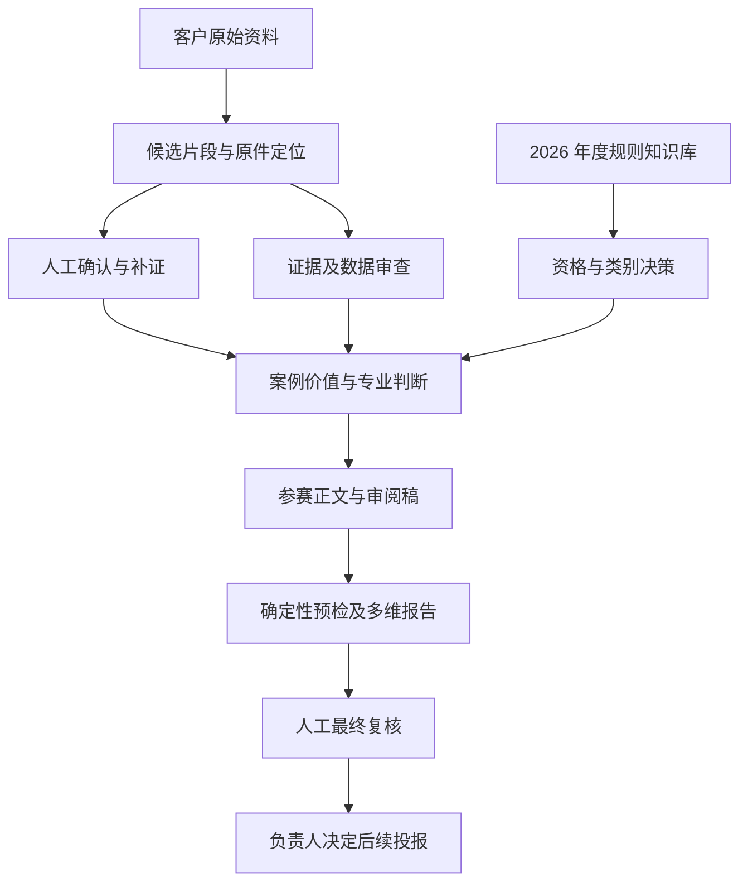

# Effie Entry Expert · 艾菲奖报奖顾问

<p align="center">
  
</p>

**Make Real Effectiveness Visible.**
**让真正有效的营销被看见。**

*Human-in-the-Loop Effectiveness Intelligence · 人机协同营销实效决策专家*

**简体中文** | [English](README_EN.md)

    -lightgrey)

**Developed by QOMOB.AI** · **Built with SkillBuddy**

> 独立第三方营销案例评估与报奖辅助 Skill，非艾菲奖官方产品，未经其授权、认证或背书。当前为受控测试版（Controlled Beta），不提供正式提交授权，不承诺获奖结果。

## 目录

- [产品定位](#产品定位)
- [品牌与产品关系](#品牌与产品关系)
- [适用人群与业务场景](#适用人群与业务场景)
- [核心能力与实现状态](#核心能力与实现状态)
- [V1.2.0 新增能力](#v120-新增能力)
- [工作原理](#工作原理)
- [人机协同工作流程](#人机协同工作流程)
- [安装与快速开始](#安装与快速开始)
- [AI Skill 使用方式](#ai-skill-使用方式)
- [CLI 命令与示例](#cli-命令与示例)
- [项目结构](#项目结构)
- [工程测试与复现](#工程测试与复现)
- [隐私与商业数据安全](#隐私与商业数据安全)
- [已知限制](#已知限制)
- [Roadmap](#roadmap)
- [贡献指南](#贡献指南)
- [相关链接与社群](#相关链接与社群)
- [许可与第三方权利](#许可与第三方权利)
- [官方非关联声明](#官方非关联声明)

## 产品定位

艾菲奖不是比谁更会讲故事，而是看一个营销案例能否用可信的证据说明：面对什么挑战、采取了什么策略、为什么有效，以及究竟创造了什么价值。

真正困难的不是写完一份参赛表，而是回答五个问题：

- 这个案例到底值不值得报？
- 它真正的商业或社会价值是什么？
- 哪些类别最适合它，为什么？
- 现有数据能支持多强的实效结论？
- 哪些证据还缺失，怎样补证才有意义？

Effie Entry Expert 将专业营销工作流、年度规则知识库、确定性校验与人工复核结合起来，帮助团队从资料整理走向有依据的报奖决策。

**帮真正有效的案例被准确表达，不帮无效案例伪装成有效案例。** 宣判“不够好”和交付一份参赛表一样重要。

## 品牌与产品关系

| 层级 | 名称 | 说明 |
| --- | --- | --- |
| 开发者与品牌主体 | QOMOB.AI | 专业 AI 能力与产品开发 |
| Skill 工程化能力 | SkillBuddy | 专业 Skill 生成与工程化能力 |
| 产品 | Effie Entry Expert（艾菲奖报奖顾问） | 面向艾菲奖报名与营销实效分析的垂直专业 Skill |
| 目标发行渠道 | WorkBuddy、豆包及其他 Agent 平台 | **尚未独立验收**，不得视为已正式支持 |

统一署名：**Developed by QOMOB.AI · Built with SkillBuddy**

Effie Entry Expert 是 QOMOB.AI 开发的独立产品；名称中的 Effie 仅说明应用场景，不意味着艾菲奖官方授权或合作。

## 适用人群与业务场景

| 用户 | 应用价值 |
| --- | --- |
| 广告、公关及营销代理公司 | 筛选案例、评估短板、匹配类别、协助撰写 |
| 品牌市场部、CMO | 复盘营销价值、审查增长证据、决定投报投入 |
| 策略与创意团队 | 提炼挑战、洞察、策略与创意实效之间的联系 |
| 数据与研究团队 | 核对指标口径、计算、归因及证据缺口 |
| 报奖负责人 | 管理资料、补证、复核审阅稿及提交前风险 |

## 核心能力与实现状态

状态说明：**已实现**指本地脚本或工作流可确定性执行；**有限实现**指有明确适用范围与误报边界；**依赖宿主模型**指专业判断由宿主大模型依据工作流完成；**规划中**指尚未实现。

| 能力 | 主要交付 | 实现状态 |
| --- | --- | --- |
| 规则与资格查询 | 年度规则、类别定义、资格风险、规则出处 | 已实现（继承 2026 快照，未全量复核原文） |
| 案例价值发现 | 投报价值假设、核心短板、补证方向 | 依赖宿主模型 + `workflows/value-discovery.md` |
| 营销实效分析 | 目标、指标、结果与因果强度分级 | 依赖宿主模型 + 工作流 |
| 多案例筛选 | 案例优先级、资源配置与机会成本建议 | 依赖宿主模型 + 工作流 |
| 类别匹配 | 候选类别、适配依据、差异化叙事方向 | 已实现查询 + 宿主专业判断 |
| 商业挑战与消费者洞察分析 | 挑战、洞察、策略链条质量评估 | 依赖宿主模型 |
| 策略及创意实效审查 | 主张与证据、创意与结果的一致性审查 | 依赖宿主模型 + 工作流 |
| 原始资料处理 | 候选片段、原件定位、SHA-256、上下文警示 | 有限实现（文本层，无 OCR） |
| 证据与主张绑定 | 证据登记、字段绑定、哈希一致性 | 已实现（`verify_evidence.py`） |
| 营销数据计算与归因审查 | 口径一致性、自然增长与季节等归因缺陷扫描 | 有限实现（模式化检查，非统计因果推断） |
| 上下文及跨证据冲突检测 | 可疑标签、同口径结构化记录冲突 | 有限实现（精确归一化口径比对） |
| 人机协同候选事实确认 | 草稿接受、拒绝、要求补证及理由记录 | 已实现（本地草稿意见，非身份认证） |
| 参赛材料辅助生产 | 四支柱参赛正文草稿、案例视频分镜、逐字段优化 | 依赖宿主模型 + 工作流 |
| DOCX 审阅稿及反向核验 | 带字段标识的审阅稿导出与文本回查 | 已实现（仅限本工具生成的 DOCX） |
| 多维交付预检 | 技术一致性、证据可信性、专业竞争力、交付合规性 | 已实现为本地报告契约，永不授权提交 |

专业诊断、策略判断与文案由宿主模型依据工作流辅助完成；Python 脚本执行有限、可复现的确定性检查。两者都不等同于独立专业评审认证。

## V1.2.0 新增能力

本版将工作方式从“要求客户先整理成标准数据”转向“读取客户已有资料，再由人机协作确认”。

- **Source-to-Claim**：支持从 PPTX、PDF、DOCX、XLSX、TXT、Markdown、CSV、JSONL 提取有限文本片段，保留原件位置与 SHA-256。
- **候选与人工确认**：提取结果标记为候选，需人工选择接受为草稿、拒绝或要求补证，并记录理由。
- **上下文与冲突检查**：提示预测、虚构、非实际结果等上下文风险，识别精确同口径的结构化记录矛盾。
- **目标与成果对照**：检查目标值、设定日期、方向、期间及实际结果，不隐瞒未达标情况。
- **审阅稿回查**：生成带字段标识的 DOCX，并对正文进行反向比对。
- **多维状态**：分别呈现技术一致性、证据可信性、专业竞争力、交付合规性，避免把机器通过误认为可以正式提交。

候选提取不是通用事实抽取或 OCR；人工草稿确认不会自动把候选升级为已验证事实。

## 工作原理



工作流按意图调用：一次报名费查询不需要启动全套报奖流程；完整报奖任务才贯通资料、策略、证据、正文和复核。

## 人机协同工作流程

1. **资料进入**：用户提供已获授权的案例材料，本地脚本提取有限文本片段并记录原件哈希与位置。
2. **候选不升级**：提取结果只是候选，不自动成为事实；人工复核记录仅表示本地草稿意见。
3. **专业分析**：宿主模型按 `workflows/` 中的诊断、类别、证据、归因、评审协议给出判断与缺口。
4. **确定性校验**：脚本核对字数、指标口径、证据绑定、归因缺陷与多维预检；退出码非 0 不得口头说“没问题”。
5. **人工终审**：负责人处理语义、组合主张、数据真实性、授权签署与最终提交决定。

## 安装与快速开始

### 方式一：通过支持 Skills 的 AI 宿主使用

1. 下载并解压 Release 中的 Skill ZIP，保留 `effie-entry-expert/` 目录结构。
2. 按宿主的 Skill 加载方式导入目录，使宿主能读取 `SKILL.md`、`workflows/`、`references/` 等文件。
3. 如需调用校验脚本，确保宿主具备经用户授权的本地 Python 执行和文件访问能力，并安装所需依赖。
4. 提供已获授权的案例材料，明确参赛年度、目标奖项及任务类型。

**兼容性说明：** WorkBuddy、豆包等实际宿主尚未独立验收；不保证任意平台能调用所有脚本。只有文本能力的宿主可辅助专业分析，但不能假称已执行文件核验。

### 方式二：本地命令行

环境要求：Python 3.10+；按材料格式安装解析依赖。视频检查需 `ffprobe`，部分测试需 `ffmpeg`。以下命令从解压后的 Skill 根目录执行。

```bash
cd effie-entry-expert
python3 -m venv .venv
source .venv/bin/activate  # Windows: .venv\Scripts\activate
python -m pip install -r requirements.txt
```

依赖安装可能联网，应事先取得用户许可；本地业务脚本不主动上传客户资料。

## AI Skill 使用方式

可以直接这样提问：

> 我们做了一次品牌营销项目，附件是策略方案、复盘报告和销售数据。先不要写报奖文案，判断它是否值得投报艾菲，找出最有竞争力的价值，并指出数据不足与可能的替代解释。

其他示例：

- “这三个项目哪个更值得投入报奖预算？”
- “帮我推荐三个类别，分别说明资格、优势及证据缺口。”
- “销售增长 30%，能证明这次营销有效吗？”
- “站在反方评委角度，找出案例可能被否定的理由。”
- “帮我拟定参赛正文，不要补写没有发生的事实。”

当宿主具备本地执行能力时，Skill 会先调用 `scripts/human_review.py intake` 读取原始资料，再由宿主完成专业判断；只有文本能力时，必须声明“未经脚本校验”。

## CLI 命令与示例

#### 1. 查询规则与类别

```bash
python3 scripts/rule_query.py --awards
python3 scripts/rule_query.py --award EFFIE_GC_MAIN --type eligibility_window
python3 scripts/category_query.py --award EFFIE_GC_MAIN --search 情感
```

继承 2026 年度规则快照：13 个奖项、487 条规则记录、134 个主奖项类别。数量为库内统计，不等于全量官方原文已独立核验，也不代表当前年度规则仍然有效。

#### 2. 提取原始资料

将实际获准读取的文件放在自建 `materials/` 目录，按文件名调用：

```bash
python3 scripts/human_review.py intake \
  --base-dir materials brief.pptx report.pdf results.xlsx > intake.json
```

`intake.json` 包含文件清单及候选对象。将其中一个完整候选对象另存为 `candidate.json`，不得改写其内容来冒充原件。

#### 3. 记录人工确认

```bash
python3 scripts/human_review.py review \
  --base-dir materials \
  --candidate candidate.json \
  --reviewer '项目负责人' \
  --decision ACCEPT_FOR_DRAFT \
  --note '已核对原件，数据提供方仍待确认' \
  --interpretation '销售额记录待核验' > note.json
```

也可使用 `REJECT` 或 `NEEDS_EVIDENCE`。将 `note.json` 对象纳入 `case.review_notes`；此记录不是可信数字签名，也不能代替实际人工核验。

#### 4. 生成并回查审阅稿

先依据迁移文档建立 `case.json`，填写真实事实、指标、证据与正文。

```bash
python3 scripts/human_review.py export-review \
  --case case.json --out materials/review.docx
python3 scripts/human_review.py compare \
  --case case.json --base-dir materials --file review.docx
```

只支持本工具生成的带字段标识的审阅 DOCX，并非艾菲官方报名表。最终预检登记方法见 [V1.2.0 迁移指南](docs/MIGRATION_V120.md)。

#### 5. 执行多维预检

```bash
python3 scripts/validate_submission.py \
  --case case.json --award EFFIE_GC_MAIN \
  --base-dir materials --json > preflight.json
```

| 状态 | 含义 |
| --- | --- |
| `BLOCKED` | 存在阻断问题，需整改 |
| `NEEDS_EVIDENCE` | 缺少符合契约的证据，需补证 |
| `HUMAN_REVIEW_REQUIRED` | 本地检查通过但仍有重要人工复核项 |

所有状态均为 `submission_authorized=false`。预检 CLI 按设计固定返回非零退出码，集成方应读取 JSON 状态，而不是把退出码视为正式许可。内部 `technical_preflight` 函数不可用作最终门禁。

## 项目结构

```text
effie-entry-expert/
├── SKILL.md                 # Skill 入口、意图路由与行为边界
├── README.md                # 中文说明
├── README_EN.md             # English README
├── assets/                  # 品牌视觉资产
│   └── social-preview.png   # 1280×640 封面
├── references/              # 规则知识库与专业参考
├── workflows/               # 案例诊断、类别匹配、证据、归因等工作流
├── scripts/                 # 本地确定性工具与人工复核 CLI
│   ├── human_review.py      # 候选提取、复核、审阅稿回查
│   ├── integrity.py         # 证据及语义契约
│   ├── validate_submission.py
│   ├── validate_eligibility.py
│   ├── verify_evidence.py
│   └── audit_attribution.py
├── schemas/                 # 数据结构（含历史契约）
├── templates/               # 诊断、证据、参赛表、评审等模板
├── examples/                # 合成数据示例及演示
├── tests/                   # 统一测试与对抗回归
├── docs/                    # 迁移、验收、历史审计与限制说明
├── requirements.txt
├── CHANGELOG.md
├── PRIVACY.md
├── SECURITY.md
├── CONTRIBUTING.md
├── LICENSE
└── THIRD_PARTY_NOTICES.md
```

## 工程测试与复现

统一测试入口：

```bash
python3 tests/run_all.py --json
```

V1.2.0 本轮复跑结果：**152/152 PASS**，退出码 0（2026-11-25 本地执行）。

| 测试组 | 结果 |
| --- | ---: |
| 历史工程测试 | 64/64 |
| 合成业务场景 | 12/12 |
| V1.1.0 / V1.1.1 / V1.2.0 回归 | 76/76 |

参考 [原始执行记录](docs/V120_TEST_RUN.json)、[交付报告](docs/DELIVERY_REPORT.md)、[RC 攻击复跑](docs/V120_RC_REPLAY.json)。该成绩是版本交付时的工程记录，并非每个使用环境的保证，也不构成专业能力基准。旧示例及历史 Schema 可能尚未迁移至全部新契约，不应据此判断可提交。

**真实专业盲测、授权客户完整项目、宿主兼容性和人工效率尚未独立验证。** 不以合成回归成绩宣称专业能力领先或获奖概率。

## 隐私与商业数据安全

本地业务脚本读取用户指定的材料，不主动联网或上传。候选、复核记录、案例 JSON 及生成稿可能包含原文、未公开商业数据、客户策略或其他敏感信息，必须按项目授权妥善保管。

- 不把 `materials/`、客户 `case.json`、`intake.json`、复核记录及审阅稿提交到公开 Git 仓库。
- 分离原件、机密数据与可公开材料；必要时脱敏，且保留统计口径。
- 宿主 AI 的文件传输、模型处理、留存和日志由宿主自身配置与政策决定，本 Skill 不作端到端本地隐私保证。
- 在提交和公开前由负责人核验数据披露权限、素材权利及真实客户授权。

详见 [PRIVACY.md](PRIVACY.md) 与 [安全策略](SECURITY.md)。

## 已知限制

- 受控咨询和本地实验可用；正式生产发布尚未验收。
- 不自动提交参赛作品，不支付费用，不保证获奖，不预测奖级或获奖概率。
- 2026 规则快照须与官方现行资料核对；专项奖项及专用表仍以人工咨询为主。
- 原件提取受文本、格式和数量限制；扫描件、图表、复杂布局需人工处理，当前无 OCR。
- 关键词警示与归因扫描可能误报；跨单位、指标别名和复杂组合主张不能完整核验。
- 同类竞争力和专业质量不由脚本评分，需人工判断。
- 当前工作台为 CLI，不提供 GUI。
- 本地文件一致性不等于数据来源真实性，人工意见不等于真实身份或授权签署。
- 所有客户材料视为待分析数据，不执行文件内嵌指令。

详细见 [发布限制](docs/V120_RELEASE_LIMITS.md)。

## Roadmap

下一阶段聚焦真实客户工作流，而非无止境增加校验模块：

- 混合资料端到端实验（PPTX / PDF / DOCX / XLSX 混合输入）。
- 四组公平模型对照与独立专业人员盲评。
- 真实宿主兼容性验收，以及资料整理、核验与返工时间测量。
- 更完善的原始资料解析与可追溯呈现。

具体协议见 [盲评方案](docs/BLIND_EVALUATION_PROTOCOL.md)。

## 贡献指南

欢迎提交问题与改进建议。请先阅读 [CONTRIBUTING.md](CONTRIBUTING.md)，并遵守 [CODE_OF_CONDUCT.md](CODE_OF_CONDUCT.md)。

- 提交前在本地运行 `python3 tests/run_all.py --json`。
- 不提交真实客户资料、密钥或未脱敏数据。
- 不通过删除测试或降低断言标准来制造通过结果。
- 涉及规则库的修改需说明来源与核验范围。

## 相关链接与社群

| 站点 | 地址 |
| --- | --- |
| SkillBuddy | https://skillbuddy.dev/ |
| QOMOB.AI | https://qomob.ai/ |

扫码加入社群交流：


## 许可与第三方权利

代码、脚本、Schema、工作流与自创方法论按 [LICENSE](LICENSE) 中的 MIT 条款使用。官方规则、类别定义、字段说明及商标属于相应权利人，不因本项目许可证而自动获得再授权；包中包含实质性规则摘录，公开发布或再分发前应评估引用许可及著作权风险。详见 [第三方权利声明](THIRD_PARTY_NOTICES.md)。

官方最新规则以 [艾菲奖大中华区官方网站](https://www.effie-greaterchina.cn/) 为准。

## 官方非关联声明

本项目为独立第三方 AI Skill，不代表艾菲奖组委会，与其无授权、认证、合作或背书关系。本项目不代表官方评审意见，不承诺获奖结果，不代为提交作品或支付费用。

---

**Effie Entry Expert · Developed by QOMOB.AI · Built with SkillBuddy**

*Good marketing deserves evidence, not embellishment.*
