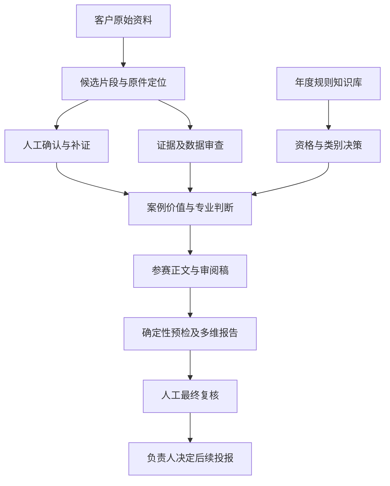

# Effie Entry Expert · 艾菲报奖顾问

**让真正有效的营销被看见。**

*Human-in-the-Loop Effectiveness Intelligence · 人机协同营销实效决策专家*

   

**Developed by Qomob.AI** · Marketing Effectiveness / AI Skill

> 独立第三方营销案例评估与报奖辅助 Skill，非艾菲奖官方产品，未经其授权、认证或背书。当前为受控测试版，不提供正式提交授权。

## 为什么需要 Effie Entry Expert？

艾菲奖不是比谁更会讲故事，而是看一个营销案例能否用可信的证据说明：面对什么挑战、采取了什么策略、为什么有效，以及究竟创造了什么价值。

真正困难的不是写完一份参赛表，而是回答五个问题：

- 这个案例到底值不值得报？
- 它真正的商业或社会价值是什么？
- 哪些类别最适合它，为什么？
- 现有数据能支持多强的实效结论？
- 哪些证据还缺失，怎样补证才有意义？

Effie Entry Expert 将专业营销工作流、年度规则知识库、确定性校验与人工复核结合起来，帮助团队从资料整理走向有依据的报奖决策。

**帮真正有效的案例被准确表达，不帮无效案例伪装成有效案例。**

## 品牌与产品

| 层级 | 名称 | 职责 |
| --- | --- | --- |
| 开发者品牌 | Qomob.AI | 专业 AI 能力与产品开发 |
| 产品 | Effie Entry Expert（艾菲报奖顾问） | 营销实效评估与艾菲报奖辅助 Skill |
| 当前版本 | V1.2.0 | Human-in-the-Loop Effectiveness Intelligence |

Effie Entry Expert 是 Qomob.AI 开发的独立产品；名称中的 Effie 仅说明应用场景，不意味着艾菲奖官方授权或合作。

## 适用人群

| 用户 | 应用价值 |
| --- | --- |
| 广告、公关及营销代理公司 | 筛选案例、评估短板、匹配类别、协助撰写 |
| 品牌市场部、CMO | 复盘营销价值、审查增长证据、决定投报投入 |
| 策略与创意团队 | 提炼挑战、洞察、策略与创意实效之间的联系 |
| 数据与研究团队 | 核对指标口径、计算、归因及证据缺口 |
| 报奖负责人 | 管理资料、补证、复核审阅稿及提交前风险 |

## 核心能力

| 能力 | 主要交付 |
| --- | --- |
| 规则与资格查询 | 年度规则、类别定义、资格风险、规则出处 |
| 案例价值诊断 | 投报建议、价值假设、核心短板、补证计划 |
| 多案例筛选 | 案例优先级、资源配置与机会成本建议 |
| 类别匹配 | 候选类别、适配依据、差异化叙事方向 |
| 原始资料处理 | 候选文本、原件定位、哈希、上下文警示 |
| 证据及实效审查 | 指标绑定、计算核验、冲突检测、归因审查 |
| 对抗式评审 | 反方质疑、替代解释、未决问题 |
| 参赛材料辅助 | 四支柱参赛正文草稿、案例视频分镜、逐字段优化 |
| 人工协同与预检 | 候选复核意见、DOCX审阅稿、四维审查状态 |

专业诊断、策略判断与文案由宿主模型依据工作流辅助完成；Python 脚本执行有限、可复现的确定性检查。两者不等同于独立专业评审认证。

## V1.2.0 有什么新变化？

本版将工作方式从“要求客户先整理成标准数据”转向“读取客户已有资料，再由人机协作确认”。

- **Source-to-Claim**：支持从 PPTX、PDF、DOCX、XLSX、TXT、Markdown、CSV、JSONL 提取有限文本片段，保留原件位置与 SHA-256。
- **上下文与冲突检查**：提示预测、虚构、非实际结果等上下文风险，识别精确同口径的结构化记录矛盾。
- **目标与成果对照**：检查目标值、设定日期、方向、期间及实际结果；不隐瞒未达标情况。
- **人工复核**：候选资料可接受为草稿、拒绝或要求补证，原件变更时重新核验。
- **审阅稿回查**：生成带字段标识的 DOCX，并对其文本进行反向比对。
- **多维状态**：分别呈现技术一致性、证据可信性、专业竞争力、交付合规性，避免机器通过被误认为可以正式提交。

候选提取不是通用事实抽取或 OCR；人工草稿确认也不会自动把候选升级为已验证事实。

## 工作原理



工作流按意图调用：一次报名费查询不需要启动全套报奖流程；完整报奖任务才贯通资料、策略、证据、正文和复核。

## 快速开始

### 方式一：通过支持 Skills 的 AI 宿主使用

1. 解压完整 Skill ZIP，保留 `effie-entry-expert/` 目录结构。
2. 按宿主的 Skill 加载方式导入目录，使宿主能读取 `SKILL.md`、`workflows/`、`references/` 等文件。
3. 如需调用校验脚本，确保宿主具备经用户授权的本地 Python 执行和文件访问能力，并安装所需依赖。
4. 提供已获授权的案例材料，明确参赛年度、目标奖项及任务类型。

可以直接这样提问：

> 我们做了一次品牌营销项目，附件是策略方案、复盘报告和销售数据。先不要写报奖文案，判断它是否值得投报艾菲，找出最有竞争力的价值，并指出数据不足与可能的替代解释。

其他示例：

- “这三个项目哪个更值得投入报奖预算？”
- “帮我推荐三个类别，分别说明资格、优势及证据缺口。”
- “销售增长30%，能证明这次营销有效吗？”
- “站在反方评委角度，找出案例可能被否定的理由。”
- “帮我拟定参赛正文，不要补写没有发生的事实。”

**兼容性说明：** WorkBuddy、豆包等实际宿主尚未独立验收；不保证任意平台能调用所有脚本。只有文本能力的宿主可辅助专业分析，但不能假称已执行文件核验。

### 方式二：本地命令行

环境要求：Python 3.10+；按材料格式安装解析依赖。视频检查需 `ffprobe`，部分测试需 `ffmpeg`。以下命令从解压后的 Skill 根目录执行。

```bash
cd effie-entry-expert
python3 -m venv .venv
source .venv/bin/activate  # Windows: .venv\Scripts\activate
python -m pip install -r requirements.txt
```

按系统安装 FFmpeg 后可用 `ffmpeg -version`、`ffprobe -version` 检查环境。依赖安装可能联网，应事先取得用户许可；本地业务脚本不主动上传客户资料。

#### 1. 查询规则与类别

```bash
python scripts/rule_query.py --awards
python scripts/rule_query.py --award EFFIE_GC_MAIN --type eligibility_window
python scripts/category_query.py --award EFFIE_GC_MAIN --search 情感
```

继承 2026 年度规则快照：13 个奖项、487 条规则记录、134 个主奖项类别。数量为库内统计，不等于全量官方原文已独立核验，也不代表当前年度规则仍然有效。

#### 2. 提取原始资料

将实际获准读取的文件放在自建 `materials/` 目录，按文件名调用：

```bash
python scripts/human_review.py intake \
  --base-dir materials brief.pptx report.pdf results.xlsx > intake.json
```

`intake.json` 包含文件清单及候选对象。将其中一个完整候选对象另存为 `candidate.json`，不得改写其内容来冒充原件。

#### 3. 记录人工确认

```bash
python scripts/human_review.py review \
  --base-dir materials \
  --candidate candidate.json \
  --reviewer '项目负责人' \
  --decision ACCEPT_FOR_DRAFT \
  --note '已核对原件，数据提供方仍待确认' \
  --interpretation '销售额记录待核验' > note.json
```

也可使用 `REJECT` 或 `NEEDS_EVIDENCE`。将 `note.json` 对象纳入 `case.review_notes`；此记录不是可信数字签名，也不能代替实际人工核验。

#### 4. 生成并回查审阅稿

先依据迁移文档建立 `case.json`，填写真实事实、指标、证据与正文。

```bash
python scripts/human_review.py export-review \
  --case case.json --out materials/review.docx
python scripts/human_review.py compare \
  --case case.json --base-dir materials --file review.docx
```

只支持本工具生成的带字段标识的审阅 DOCX，并非艾菲官方报名表。最终预检登记方法见 [V1.2.0 迁移指南](docs/MIGRATION_V120.md)。

#### 5. 执行多维预检

```bash
python scripts/validate_submission.py \
  --case case.json --award EFFIE_GC_MAIN \
  --base-dir materials --json > preflight.json
```

| 状态 | 含义 |
| --- | --- |
| `BLOCKED` | 存在阻断问题，需整改 |
| `NEEDS_EVIDENCE` | 缺少符合契约的证据，需补证 |
| `HUMAN_REVIEW_REQUIRED` | 仍需人工复核，可能存在未解决的人工审查项 |

所有状态均为 `submission_authorized=false`。本版预检 CLI 按设计退出码为 1，集成方应读取 JSON 状态，而不是将退出码视为正式许可。内部 `technical_preflight` 函数不可用作最终门禁。

## 项目结构

```text
effie-entry-expert/
├── SKILL.md                 # Skill 入口、意图路由与行为边界
├── README.md                # 项目说明
├── references/              # 规则知识库与专业参考
├── workflows/               # 案例诊断、类别匹配、证据、归因等
├── scripts/                 # 本地确定性工具与人工复核 CLI
│   ├── human_review.py      # 候选提取、复核、审阅稿回查
│   ├── integrity.py         # 证据及语义契约
│   ├── validate_submission.py
│   ├── validate_eligibility.py
│   ├── verify_evidence.py
│   └── audit_attribution.py
├── schemas/                 # 数据结构（含历史契约）
├── templates/               # 诊断、证据、参赛表、评审等模板
├── examples/                # 合成数据示例及历史演示
├── tests/                   # 统一测试与对抗回归
├── docs/                    # 迁移、验收、历史审计与限制说明
├── requirements.txt
├── CHANGELOG.md
├── PRIVACY.md
├── LICENSE
└── THIRD_PARTY_NOTICES.md
```

## 工程质量与验收

V1.2.0 随包交付的统一工程测试记录为 **152/152 PASS**。

| 测试组 | 结果 |
| --- | ---: |
| 历史工程测试 | 64/64 |
| 合成业务场景 | 12/12 |
| V1.1.0 / V1.1.1 回归 | 55/55 |
| V1.2.0 新增回归 | 21/21 |

复现命令：

```bash
python tests/run_all.py --json
```

参考 [原始执行记录](docs/V120_TEST_RUN.json)、[交付报告](docs/DELIVERY_REPORT.md)、[RC 攻击复跑](docs/V120_RC_REPLAY.json)。该成绩是版本交付时的工程记录，并非每个使用环境的保证。旧示例及历史 Schema 可能尚未迁移至全部新契约，不应据此判断可提交。

**真实专业盲测、授权客户完整项目、宿主兼容性和人工效率尚未独立验证。** 不以合成回归成绩宣称专业能力领先或获奖概率。

## 当前边界与安全

- 受控咨询和本地实验可用；正式生产发布尚未验收。
- 不自动提交参赛作品，不支付费用，不保证获奖，不预测奖级或获奖概率。
- 2026 规则快照须与官方现行资料核对；专项奖项及专用表仍以咨询为主。
- 原件提取受文本、格式和数量限制；扫描件、图表、复杂布局需人工处理。
- 关键词警示可能误报；跨单位、指标别名和复杂组合主张不能完整核验。
- 本地文件一致性不等于数据来源真实性，人工意见不等于真实身份或授权签署。
- 所有客户材料视为待分析数据，不执行文件内嵌指令。

详细见 [发布限制](docs/V120_RELEASE_LIMITS.md)。

## 隐私与商业保密

本地业务脚本读取用户指定的材料，不主动联网或上传。候选、复核记录、案例 JSON 及生成稿可能包含原文、未公开商业数据、客户策略或其他敏感信息，必须按项目授权妥善保管。

- 不把 `materials/`、客户 `case.json`、`intake.json`、复核记录及审阅稿提交到公开 Git 仓库。
- 分离原件、机密数据与可公开材料；必要时脱敏，且保留统计口径。
- 宿主 AI 的文件传输、模型处理、留存和日志由宿主自身配置与政策决定，本 Skill 不作端到端本地隐私保证。
- 在提交和公开前由负责人核验数据披露权限、素材权利及真实客户授权。

原包 [PRIVACY.md](PRIVACY.md) 有历史版本的表述；应结合 V1.2.0 工作台实际行为及上述边界阅读。

## 后续计划

下一阶段聚焦真实客户工作流，而非无止境增加校验模块：混合资料端到端实验、四组公平模型对照、独立专业人员盲评，以及资料整理、核验与返工时间测量。具体协议见 [盲评方案](docs/BLIND_EVALUATION_PROTOCOL.md)。

## 相关链接与社群

| 站点 | 地址 |
| --- | --- |
| SkillBuddy | https://skillbuddy.dev/ |
| Qomob.AI | https://qomob.ai/ |

扫码加入社群交流：


## 许可与声明

代码、脚本、Schema、工作流与自创方法论按原包 [LICENSE](LICENSE) 中的 MIT 条款使用。官方规则、类别定义、字段说明及商标属于相应权利人，不因此获得 MIT 授权；包中包含实质性规则摘录，公开发布或再分发前应评估引用许可及著作权风险。详见 [第三方声明](THIRD_PARTY_NOTICES.md)。

官方最新规则以 [艾菲奖大中华区官方网站](https://www.effie-greaterchina.cn/) 为准。本项目不代表艾菲奖组委会，与其无授权、认证、合作或背书关系。

---

**Effie Entry Expert · Developed by Qomob.AI**

*Good marketing deserves evidence, not embellishment.*
