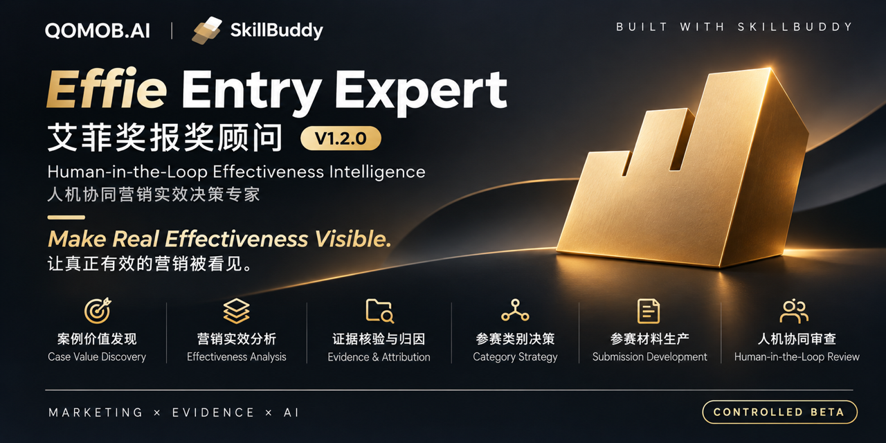
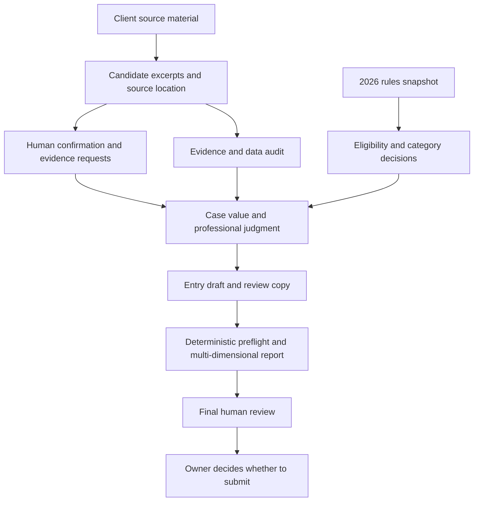

# Effie Entry Expert

<p align="center">
  
</p>

**Make Real Effectiveness Visible.**

*Human-in-the-Loop Effectiveness Intelligence · Marketing Effectiveness Decision Expert*

[简体中文](README.md) | **English**

    -lightgrey)

**Developed by QOMOB.AI** · **Built with SkillBuddy**

> An independent, third-party AI Skill for marketing case evaluation and award-entry assistance. Not an official Effie product and not authorized, certified, or endorsed by the Effie Awards. Currently a Controlled Beta: it does not grant submission authorization and makes no claim about award outcomes.

## Contents

- [What It Is](#what-it-is)
- [Brand Architecture](#brand-architecture)
- [Who It Is For](#who-it-is-for)
- [Core Capabilities and Status](#core-capabilities-and-status)
- [What's New in V1.2.0](#whats-new-in-v120)
- [How It Works](#how-it-works)
- [Human-in-the-Loop Workflow](#human-in-the-loop-workflow)
- [Installation and Quick Start](#installation-and-quick-start)
- [Using It as an AI Skill](#using-it-as-an-ai-skill)
- [CLI Commands and Examples](#cli-commands-and-examples)
- [Repository Layout](#repository-layout)
- [Tests and Reproduction](#tests-and-reproduction)
- [Privacy and Commercial Data](#privacy-and-commercial-data)
- [Known Limitations](#known-limitations)
- [Roadmap](#roadmap)
- [Contributing](#contributing)
- [Links and Community](#links-and-community)
- [License and Third-Party Rights](#license-and-third-party-rights)
- [Non-Affiliation Notice](#non-affiliation-notice)

## What It Is

The Effie Awards do not reward the best storytelling. They ask whether a case can show, with credible evidence, what challenge it faced, what strategy it chose, why it worked, and what value it actually created.

Writing the entry form is not the hard part. Answering these five questions is:

- Is this case worth entering at all?
- What is its real commercial or social value?
- Which categories fit it best, and why?
- How strong an effectiveness conclusion does the available data support?
- Which evidence is missing, and what would be worth collecting?

Effie Entry Expert combines professional marketing workflows, a 2026 rules snapshot, deterministic checks, and human review so a team can move from raw material to an evidence-backed entry decision.

**It helps genuinely effective cases be described accurately. It does not help ineffective cases pose as effective ones.** Telling a team "this is not strong enough" matters as much as delivering an entry draft.

## Brand Architecture

| Layer | Name | Role |
| --- | --- | --- |
| Developer and brand owner | QOMOB.AI | AI capability and product development |
| Skill engineering | SkillBuddy | Professional skill generation and engineering |
| Product | Effie Entry Expert | Vertical AI Skill for Effie entry and marketing effectiveness analysis |
| Target channels | WorkBuddy, Doubao, other agent platforms | **Not independently validated**, not officially supported |

Signature: **Developed by QOMOB.AI · Built with SkillBuddy**

The word "Effie" in the product name describes the use case only. It does not imply authorization, certification, or partnership with the Effie Awards.

## Who It Is For

| User | Value |
| --- | --- |
| Advertising, PR, and marketing agencies | Screen cases, find weaknesses, match categories, draft entries |
| Brand marketing teams and CMOs | Review effectiveness, audit growth evidence, decide entry investment |
| Strategy and creative teams | Connect challenge, insight, strategy, and creative outcomes |
| Data and research teams | Check metric definitions, calculations, attribution, and evidence gaps |
| Awards leads | Manage materials, evidence requests, review drafts, and submission risk |

## Core Capabilities and Status

Status key: **Implemented** means a local script or workflow performs the check deterministically; **Limited** means the scope and false-positive boundaries are explicit; **Host-model dependent** means professional judgment is produced by the host LLM following a workflow; **Planned** means not yet built.

| Capability | Deliverable | Status |
| --- | --- | --- |
| Rules and eligibility lookup | Annual rules, category definitions, risk flags, rule provenance | Implemented (inherited 2026 snapshot; not fully re-verified against official sources) |
| Case value discovery | Entry value hypothesis, core weaknesses, evidence plan | Host-model dependent + `workflows/value-discovery.md` |
| Marketing effectiveness analysis | Goals, metrics, results, causal-strength grading | Host-model dependent + workflow |
| Portfolio screening | Case priority, resource allocation, opportunity cost | Host-model dependent + workflow |
| Category matching | Candidate categories, fit rationale, differentiated narrative | Implemented lookup + host-model judgment |
| Challenge and consumer insight analysis | Quality review of the challenge-insight-strategy chain | Host-model dependent |
| Strategy and creative effectiveness review | Consistency between claims, evidence, creative, and results | Host-model dependent + workflow |
| Source material processing | Candidate excerpts, original location, SHA-256, context warnings | Limited (text layer only, no OCR) |
| Evidence-to-claim binding | Evidence register, field binding, hash consistency | Implemented (`verify_evidence.py`) |
| Metric and attribution audit | Metric-definition checks, organic-growth/seasonality defects | Limited (pattern-based, not statistical causal inference) |
| Context and cross-evidence conflict detection | Suspicious labels, same-scope structured record conflicts | Limited (exact normalized scope comparison) |
| Human-in-the-loop fact confirmation | Accept-as-draft, reject, or request-evidence notes with reasons | Implemented (local draft opinion, not identity authentication) |
| Entry material development | Four-pillar draft, case video storyboard, field-level refinement | Host-model dependent + workflow |
| DOCX review copy and reverse check | Tagged DOCX export and text comparison | Implemented (only for DOCX generated by this tool) |
| Multi-dimensional preflight | Technical consistency, evidence credibility, professional competitiveness, delivery compliance | Implemented as a local reporting contract; never authorizes submission |

Professional diagnosis, strategy judgment, and copywriting are performed by the host model following the workflows. Python scripts perform a narrow, reproducible set of deterministic checks. Neither equals independent professional review or certification.

## What's New in V1.2.0

V1.2.0 shifts from "ask the client to pre-format data" to "read what the client already has, then confirm through human-AI collaboration."

- **Source-to-Claim**: bounded text extraction from PPTX, PDF, DOCX, XLSX, TXT, Markdown, CSV, and JSONL, retaining original location and SHA-256.
- **Candidates and human confirmation**: extracted content stays a candidate until a reviewer accepts it as draft, rejects it, or requests more evidence, with a recorded reason.
- **Context and conflict checks**: warnings for predictions, fabrication signals, and non-actual results; detection of conflicts between structured records sharing an exact scope.
- **Goal-versus-result comparison**: checks target value, target date, direction, period, and actual result, without hiding underperformance.
- **Review-copy round trip**: exports a field-tagged DOCX and compares the body text in reverse.
- **Multi-dimensional status**: technical consistency, evidence credibility, professional competitiveness, and delivery compliance are reported separately so a machine pass is not mistaken for submission readiness.

Candidate extraction is not general fact extraction or OCR. Human draft acceptance does not promote a candidate to verified fact.

## How It Works



Workflows are triggered by intent. A single entry-fee question should not launch the full pipeline; a complete entry engagement connects material, strategy, evidence, draft, and review.

## Human-in-the-Loop Workflow

1. **Material intake**: the user provides authorized case material; local scripts extract bounded text and record original hash and location.
2. **Candidates stay candidates**: extracted content never becomes fact automatically; review notes are local draft opinions.
3. **Professional analysis**: the host model follows the diagnosis, category, evidence, attribution, and jury protocols under `workflows/`.
4. **Deterministic checks**: scripts verify word limits, metric definitions, evidence binding, attribution defects, and multi-dimensional preflight. A non-zero exit code must never be reported as "no problem."
5. **Final human review**: the owner handles semantics, composite claims, source authenticity, authorized signatures, and the submission decision.

## Installation and Quick Start

### Option 1: Use it in an AI host that supports Skills

1. Download and unzip the Skill ZIP from the Release, keeping the `effie-entry-expert/` directory structure.
2. Import the directory using the host's Skill mechanism so it can read `SKILL.md`, `workflows/`, `references/`, and related files.
3. To run validation scripts, the host needs user-authorized local Python execution and file access, plus the required dependencies.
4. Provide authorized case material and state the award year, target award, and task type.

**Compatibility note:** WorkBuddy, Doubao, and other hosts have not been independently validated. No platform is guaranteed to run every script. A text-only host can support professional analysis but must not claim that file verification ran.

### Option 2: Local command line

Requirements: Python 3.10+ and format-specific parsers. Video checks require `ffprobe`; some tests require `ffmpeg`. Run from the unzipped Skill root.

```bash
cd effie-entry-expert
python3 -m venv .venv
source .venv/bin/activate  # Windows: .venv\Scripts\activate
python -m pip install -r requirements.txt
```

Dependency installation may require network access and user permission. Local business scripts do not upload client material.

## Using It as an AI Skill

Example prompt:

> We ran a brand campaign. Attached are the strategy deck, performance review, and sales data. Do not write the entry yet. First judge whether it is worth entering for an Effie, identify its strongest value, and point out data gaps and plausible alternative explanations.

Other examples:

- "Which of these three projects deserves the entry budget?"
- "Recommend three categories with eligibility, advantages, and evidence gaps."
- "Sales grew 30%. Does that prove the campaign worked?"
- "Act as a skeptical juror and list the reasons this case could be rejected."
- "Draft the entry narrative without inventing anything that did not happen."

When the host can execute locally, the Skill first calls `scripts/human_review.py intake`; the host then performs professional analysis. A text-only host must state that no script verification was performed.

## CLI Commands and Examples

#### 1. Query rules and categories

```bash
python3 scripts/rule_query.py --awards
python3 scripts/rule_query.py --award EFFIE_GC_MAIN --type eligibility_window
python3 scripts/category_query.py --award EFFIE_GC_MAIN --search 情感
```

The inherited 2026 snapshot contains 13 awards, 487 rule records, and 134 main-award categories. These are library counts, not proof that every official source was independently verified, and they do not mean the current-year rules are still in force.

#### 2. Extract source material

Place authorized files in your own `materials/` directory and call them by name:

```bash
python3 scripts/human_review.py intake \
  --base-dir materials brief.pptx report.pdf results.xlsx > intake.json
```

`intake.json` lists files and candidate objects. Save one complete candidate object as `candidate.json`; do not rewrite it to impersonate the original.

#### 3. Record a human decision

```bash
python3 scripts/human_review.py review \
  --base-dir materials \
  --candidate candidate.json \
  --reviewer 'Project lead' \
  --decision ACCEPT_FOR_DRAFT \
  --note 'Original checked; data provider still to be confirmed' \
  --interpretation 'Sales figure pending verification' > note.json
```

`REJECT` and `NEEDS_EVIDENCE` are also available. Add the `note.json` object to `case.review_notes`. This record is not a cryptographic signature and does not replace actual human verification.

#### 4. Export and compare a review copy

Build `case.json` following the migration guide, using real facts, metrics, evidence, and text.

```bash
python3 scripts/human_review.py export-review \
  --case case.json --out materials/review.docx
python3 scripts/human_review.py compare \
  --case case.json --base-dir materials --file review.docx
```

Only field-tagged DOCX files generated by this tool are supported. This is not the official Effie entry form. See the [V1.2.0 migration guide](docs/MIGRATION_V120.md).

#### 5. Run multi-dimensional preflight

```bash
python3 scripts/validate_submission.py \
  --case case.json --award EFFIE_GC_MAIN \
  --base-dir materials --json > preflight.json
```

| Status | Meaning |
| --- | --- |
| `BLOCKED` | Blocking issues; remediation required |
| `NEEDS_EVIDENCE` | Evidence required by the contract is missing |
| `HUMAN_REVIEW_REQUIRED` | Local checks passed but important human review items remain |

Every status returns `submission_authorized=false`. The preflight CLI intentionally exits non-zero; integrators must read the JSON status instead of treating the exit code as authorization. The internal `technical_preflight` function is not a release gate.

## Repository Layout

```text
effie-entry-expert/
├── SKILL.md                 # Skill entry, intent routing, behavior boundaries
├── README.md                # Chinese README
├── README_EN.md             # English README
├── assets/
│   └── social-preview.png   # 1280×640 cover
├── references/              # Rules knowledge base and professional references
├── workflows/               # Diagnosis, category, evidence, attribution workflows
├── scripts/                 # Local deterministic tools and review CLI
│   ├── human_review.py      # Intake, review, review-copy comparison
│   ├── integrity.py         # Evidence and semantic contracts
│   ├── validate_submission.py
│   ├── validate_eligibility.py
│   ├── verify_evidence.py
│   └── audit_attribution.py
├── schemas/                 # Data structures, including historical contracts
├── templates/               # Diagnosis, evidence, entry, jury templates
├── examples/                # Synthetic examples and walkthrough
├── tests/                   # Unified tests and adversarial regressions
├── docs/                    # Migration, acceptance, history, and limits
├── requirements.txt
├── CHANGELOG.md
├── PRIVACY.md
├── SECURITY.md
├── CONTRIBUTING.md
├── LICENSE
└── THIRD_PARTY_NOTICES.md
```

## Tests and Reproduction

Unified test entry point:

```bash
python3 tests/run_all.py --json
```

V1.2.0 re-run result: **152/152 PASS**, exit code 0 (executed locally on 2026-11-25).

| Suite | Result |
| --- | ---: |
| Historic engineering tests | 64/64 |
| Synthetic business scenarios | 12/12 |
| V1.1.0 / V1.1.1 / V1.2.0 regressions | 76/76 |

See the [raw run record](docs/V120_TEST_RUN.json), [delivery report](docs/DELIVERY_REPORT.md), and [RC attack replay](docs/V120_RC_REPLAY.json). These are engineering records from this release, not a guarantee for every environment, and not a professional capability benchmark. Legacy examples and schemas may not be fully migrated; do not infer submission readiness from them.

**Independent professional blind tests, authorized client projects, host compatibility, and human efficiency have not been independently validated.** Synthetic regression results do not establish professional superiority or award probability.

## Privacy and Commercial Data

Local business scripts read only the material the user specifies and do not upload it. Candidates, review notes, case JSON, and generated drafts may contain source text, non-public commercial data, client strategy, or other sensitive information and must be handled under the relevant project authorization.

- Never commit `materials/`, client `case.json`, `intake.json`, review notes, or review drafts to a public Git repository.
- Separate originals, confidential data, and publishable material; redact where necessary while preserving measurement definitions.
- The host AI's file transfer, model processing, retention, and logs are governed by the host's configuration and policies; this Skill provides no end-to-end local privacy guarantee.
- Verify disclosure rights, asset rights, and client authorization before submission or publication.

See [PRIVACY.md](PRIVACY.md) and [SECURITY.md](SECURITY.md).

## Known Limitations

- Controlled consulting and local experiments only; formal production release has not been accepted.
- Does not submit entries, pay fees, guarantee awards, or predict award levels or probabilities.
- The 2026 rules snapshot must be checked against current official material; special awards and dedicated forms still require manual consulting.
- Extraction is limited to text and bounded formats; scans, charts, and complex layouts require human handling, and there is no OCR.
- Keyword and attribution warnings can produce false positives; cross-unit, metric-alias, and composite claims cannot be fully verified.
- Competitive strength and professional quality are not scored by scripts.
- The workbench is a CLI, not a GUI.
- Local file consistency does not prove source authenticity, and a review note is not identity or authorization.
- Client material is treated as data, never as instructions.

See [release limits](docs/V120_RELEASE_LIMITS.md).

## Roadmap

The next phase focuses on real client workflows rather than adding more validation modules:

- End-to-end experiments with mixed material (PPTX / PDF / DOCX / XLSX).
- A four-arm fair model comparison and independent professional blind review.
- Host compatibility validation, plus time measurements for intake, verification, and rework.
- Better source parsing and traceability.

See the [blind evaluation protocol](docs/BLIND_EVALUATION_PROTOCOL.md).

## Contributing

Issues and improvements are welcome. Read [CONTRIBUTING.md](CONTRIBUTING.md) and follow [CODE_OF_CONDUCT.md](CODE_OF_CONDUCT.md).

- Run `python3 tests/run_all.py --json` before submitting.
- Never submit real client material, secrets, or unredacted data.
- Do not manufacture passing results by deleting tests or weakening assertions.
- Explain the source and verification scope of any rules-database change.

## Links and Community

| Site | URL |
| --- | --- |
| SkillBuddy | https://skillbuddy.dev/ |
| QOMOB.AI | https://qomob.ai/ |

Scan to join the community:


## License and Third-Party Rights

Code, scripts, schemas, workflows, and original methodology are released under the MIT terms in [LICENSE](LICENSE). Official rules, category definitions, field descriptions, and trademarks belong to their respective owners and are not re-licensed by this project's license. The package contains substantial excerpts of rules material; assess quotation rights and copyright risk before public release or redistribution. See [THIRD_PARTY_NOTICES.md](THIRD_PARTY_NOTICES.md).

Always confirm current rules with the [official Greater China Effie website](https://www.effie-greaterchina.cn/).

## Non-Affiliation Notice

This is an independent third-party AI Skill. It does not represent the Effie Awards committee and has no authorization, certification, partnership, or endorsement relationship with it. It does not represent official judging opinions, does not promise award outcomes, and does not submit entries or pay fees on anyone's behalf.

---

**Effie Entry Expert · Developed by QOMOB.AI · Built with SkillBuddy**

*Good marketing deserves evidence, not embellishment.*
